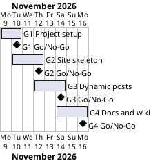

# Project Plan

## Metadata
| Key | Value |
| --- | --- |
| ID | PP-001 |
| CrossReference | [BC-001], [SA-001], [MIL-001], [MIL-002], [MIL-003], [MIL-004] |
| Language | en |
| Domain | it |

## Version History
| Date | Status | Author | Reviewer | Change | Commit |
| --- | --- | --- | --- | --- | --- |
| 2026-11-09 | Accepted | Claude (AI) for S01 | AI as stand-in for S01 | Initial version; reviewed in RC-003, Mode: autonomous, not independent | [1f11ab0] |

---

## Purpose

The plan schedules four gateways that deliver the Day 59 blog over the Business
Case constraint "the work ends by 2026-11-16" ([BC-001]). Each gateway is one
branch, one pull request, one review record and one Milestone on the git host.

## Planning Assumptions

- Week 1 starts 2026-11-09; the plan ends by 2026-11-16, per the Business Case constraint.
- Phase length: one to two days; the gateways follow the lecture's own order.
- The Product Owner, developer and reviewer is S01; in autonomous mode the AI
  is the stand-in reviewer (`Mode: autonomous, not independent`), and S01
  confirms the language criteria of `QC-LANG-001` that need a person who reads
  English and knows the IT domain when accepting this plan.
- Presentation pattern: the user interface is a server-rendered web UI, so the
  `clean-architecture` default applies in a light form: Jinja templates are the
  view, the Flask routes in the presentation layer are the controllers, and
  post data is passed as plain objects (view models). No wireframes exist
  beyond the lecture's screenshots, which serve as the first edition.
- Branches: `mil-001-project-setup`, `mil-002-site-skeleton`,
  `mil-003-dynamic-posts`, `mil-004-docs-wiki-screenshots`. Commits carry no
  AI attribution lines. Screenshots are taken in a Docker container.
- The repository is the existing remote
  `Tirsvad-Udemy-100-days-of-code/059-blog-capstone-part-2` on
  `git.tirsystem.com`.

## Gateway Schedule

| Gateway | Document | Window | Decision date | Owner | Stories | Main deliverable | Milestone |
| --- | --- | --- | --- | --- | --- | --- | --- |
| G1 Project setup and tooling | [MIL-001] | 2026-11-09 to 2026-11-10 | 2026-11-10 | S01 | none (technical) | `pyproject.toml`, layout, README, repository metadata | [Milestone 384][ms-384] |
| G2 Site skeleton (Steps 1-5) | [MIL-002] | 2026-11-10 to 2026-11-12 | 2026-11-12 | S01 | none (lecture steps) | Bootstrap site with shared header and footer, About, Contact | [Milestone 385][ms-385] |
| G3 Dynamic posts (Steps 6-7) | [MIL-003] | 2026-11-12 to 2026-11-14 | 2026-11-14 | S01 | none (lecture steps) | Posts from the API and post pages | [Milestone 386][ms-386] |
| G4 Docs and wiki | [MIL-004] | 2026-11-14 to 2026-11-16 | 2026-11-16 | S01 | none (documentation) | README, trilingual wiki, screenshots | [Milestone 387][ms-387] |



## Scope Coverage

| Business Case scope item | Gateway |
| --- | --- |
| Flask application with the Clean Blog template, header and footer includes | G2 |
| Routes for home, about, contact and individual posts | G2, G3 |
| Posts from a configurable JSON endpoint with a bundled copy | G3 |
| pytest tests | G2, G3 |
| `pyproject.toml`, `.gitignore`, `Doxyfile`, `constants.py`, `.venv` instructions | G1 |
| README and three-language wiki with screenshots | G1 (first README), G4 |
| Repository description and topics | G1 |

## Dependencies

```
G1 → G2 → G3 → G4
```

A No-Go at a gateway moves every later date by the rework time; the end date of
2026-11-16 is then re-planned with S01, not silently exceeded.

## Plan Risks

| Risk | Impact | Mitigation |
| --- | --- | --- |
| Docker image for the headless browser is slow to build | G2 and G3 screenshots late | Build the image once in G2 and reuse it |
| Translation volume (27 wiki pages) is larger than expected | G4 slips | English first; Danish and Bahasa Malaysia follow page by page; start them as soon as each English step page is final |
| Review stand-in cannot close the language criteria | Milestones stay `Go-with-conditions` and block the gate | S01 confirms criteria 3, 5 and 9 of `QC-LANG-001` at plan acceptance |

## Open Issues

- The requested repository URL `Tirsvad-Udemy-100_days_of_code` differs from the
  configured remote `Tirsvad-Udemy-100-days-of-code/059-blog-capstone-part-2`;
  the plan uses the remote and its token.
- The course's own npoint document is used as the default endpoint; creating a
  personal bin needs a browser sign-up and is left to S01 (the endpoint is a constant).
- The Governance (`GOV`) and Dictionary (`DICT`) documents are not created: the
  project has one person and no domain terms beyond the framework's; the
  traceability matrix and the review records carry the quality trail.

---

[BC-001]: ./business-case.md
[SA-001]: ./stakeholder-analysis.md
[MIL-001]: ./milestones/mil-001-project-setup.md
[MIL-002]: ./milestones/mil-002-site-skeleton.md
[MIL-003]: ./milestones/mil-003-dynamic-posts.md
[MIL-004]: ./milestones/mil-004-docs-wiki-screenshots.md
[1f11ab0]: https://git.tirsystem.com/Tirsvad-Udemy-100-days-of-code/059-blog-capstone-part-2/commit/1f11ab05fc7d3af6f6694514dc6b103f9b7d557f
[ms-384]: https://git.tirsystem.com/Tirsvad-Udemy-100-days-of-code/059-blog-capstone-part-2/milestone/384
[ms-385]: https://git.tirsystem.com/Tirsvad-Udemy-100-days-of-code/059-blog-capstone-part-2/milestone/385
[ms-386]: https://git.tirsystem.com/Tirsvad-Udemy-100-days-of-code/059-blog-capstone-part-2/milestone/386
[ms-387]: https://git.tirsystem.com/Tirsvad-Udemy-100-days-of-code/059-blog-capstone-part-2/milestone/387
